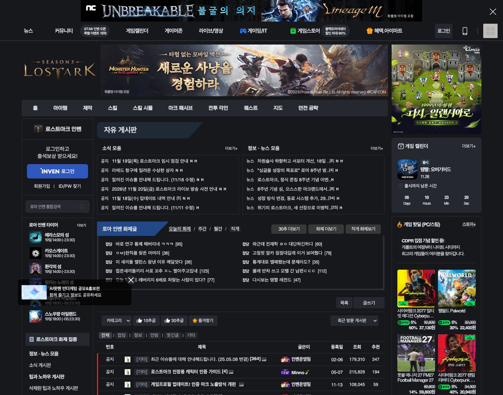
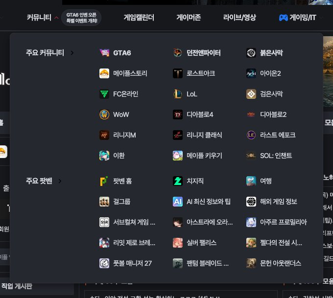

# 인벤 다크 모드 (Inven Dark, 비공식)

하얀 인벤 화면이 눈부셨다면, 인벤만 어둡게 바꿔 주는 브라우저 확장 프로그램입니다.

- **인벤에서만 동작합니다.** 다른 사이트에는 전혀 손대지 않습니다.
- **인벤 화면에 맞춰 직접 칠했습니다.** 게시판 목록, 글 보기, 댓글, 상단 메뉴, 댓글 보기 창까지 어둡고 읽기 편하게 바꿉니다. 사진, 영상, 이모티콘 색은 그대로입니다.
- **아무 정보도 모으지 않습니다.** 쓰는 권한은 "설정 저장" 하나뿐이고, 밖으로 보내는 데이터가 없습니다.
- 크롬, 웨일, 엣지 등 크롬 계열 PC 브라우저에서 쓸 수 있습니다.

> 인벤(inven.co.kr)과 관계없는 개인이 만든 비공식 도구입니다.



## 설치 방법

스토어에 올리지 않은 확장이라, 처음 한 번은 아래처럼 직접 불러와야 합니다. 2분이면 됩니다.

1. **파일 받기**
   [최신 버전 받기(Releases)](https://github.com/hyune-lab/inven-dark/releases/latest)에서 `inven-dark-v○.○.○.zip`을 내려받고 압축을 풉니다.
   압축을 푼 폴더는 지우지 말고 원하는 곳에 두세요. 브라우저가 이 폴더를 계속 읽습니다.
2. **확장 관리 화면 열기**
   주소창에 아래 주소를 입력합니다.
   - 크롬: `chrome://extensions`
   - 웨일: `whale://extensions`
   - 엣지: `edge://extensions`
3. **개발자 모드 켜기**
   오른쪽 위(엣지는 왼쪽)의 **개발자 모드** 스위치를 켭니다.
4. **불러오기**
   **압축해제된 확장 프로그램을 로드합니다** 버튼을 누르고, 1번에서 압축을 푼 폴더(`manifest.json`이 들어 있는 폴더)를 고릅니다.
5. **끝!** 인벤에 들어가 보세요. 툴바의 퍼즐 조각 아이콘에서 달 아이콘을 고정해 두면 켜고 끄기 편합니다.

> 크롬이 "개발자 모드 확장 프로그램 사용 중지" 같은 안내를 띄울 수 있습니다. 스토어를 거치지 않은 확장이라 나오는 안내이니 닫으면 됩니다.

## 사용법

툴바의 **달 아이콘**을 누르면 세 가지 중에 고를 수 있습니다.

| 선택 | 동작 |
|---|---|
| **자동** (기본) | 컴퓨터가 다크 모드일 때만 어둡게 |
| **켜기** | 항상 어둡게 |
| **끄기** | 원래 인벤 화면 |

고르는 즉시 저장되고, 열려 있는 인벤 탭에 새로고침 없이 바로 바뀝니다.

컴퓨터가 라이트 모드인데 인벤만 어둡게 보고 싶다면 **켜기**를 고르세요.



## 업데이트하는 법

1. [Releases](https://github.com/hyune-lab/inven-dark/releases/latest)에서 새 버전을 받습니다.
2. 예전 폴더 안의 파일을 새 파일로 덮어씁니다.
3. 확장 관리 화면에서 **인벤 다크 모드** 카드의 새로고침(↻) 버튼을 누르고, 인벤 탭도 새로고침합니다.

## 깨진 곳 제보

흰 바탕이 남거나 글자가 안 보이는 곳이 있으면 [이슈](https://github.com/hyune-lab/inven-dark/issues)로 알려 주세요. 아래 내용이 있으면 빨리 고칠 수 있습니다.

- 페이지 주소
- 문제 부분이 보이는 화면 캡처 (가능하면 확장을 끈 화면도 함께)

## 알려진 한계

- 휴대폰과 모바일 인벤(m.inven.co.kr)은 지원하지 않습니다. 휴대폰 브라우저는 확장 프로그램을 쓸 수 없습니다.
- 게시판, 글 보기, 댓글 중심으로 맞췄습니다. 그 밖의 화면은 기본 어둡게 처리만 되어 있어 어색한 곳이 있을 수 있습니다.
- 글쓴이가 넣은 색 글씨(빨간 글씨 등)는 읽기 쉽도록 일반 글자색으로 바뀝니다.
- 인벤이 화면을 개편하면 일부가 깨질 수 있습니다. 제보해 주시면 고치겠습니다.

## 개발자용

빌드 과정 없는 순수 JS·CSS 확장(Manifest V3)입니다.

```
manifest.json     인벤 주소(*.inven.co.kr)에서만 실행되도록 지정
src/dark.css      다크 스타일 (html[data-inven-dark="on"]일 때만 적용)
src/content.js    모드를 판단해 <html>에 표시를 붙이고 뗌, 설정 변경 즉시 반영
src/mode.js       자동·켜기·끄기 판정
src/popup.*       아이콘 창
```

```bash
npm install                # 처음 한 번 (playwright)
npm test                   # 모드 판정 단위 시험
node scripts/shoot.mjs     # 확장을 넣은 크로미움으로 인벤 화면 캡처·검사 → shots/
sh scripts/pack.sh         # 배포용 압축 파일 → dist/
```

`shoot.mjs`는 메인, 게시판 목록, 글 보기, 댓글 보기 창을 캡처합니다. 아울러 펼침 메뉴와 고정 헤더가 투명하지 않은지, 글자와 배경의 대비가 충분한지, 다른 사이트에 적용되지 않는지 확인합니다.

## 라이선스

[MIT](LICENSE)
